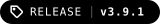
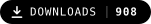
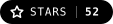
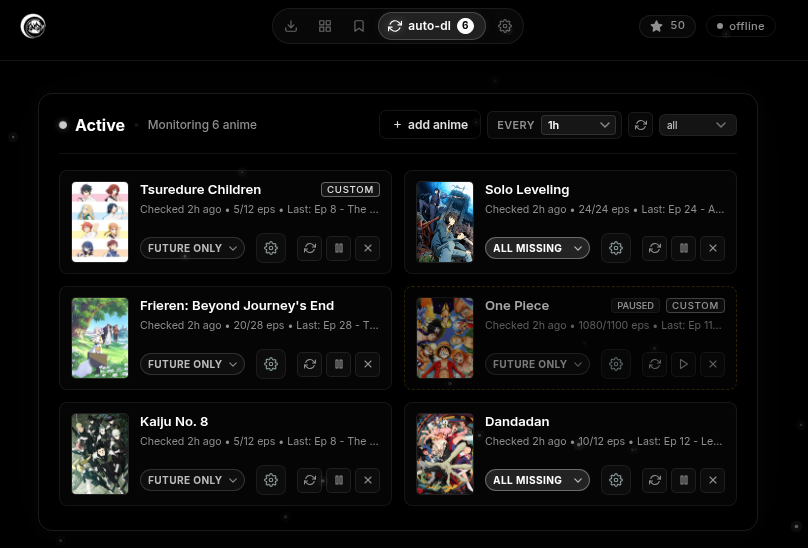
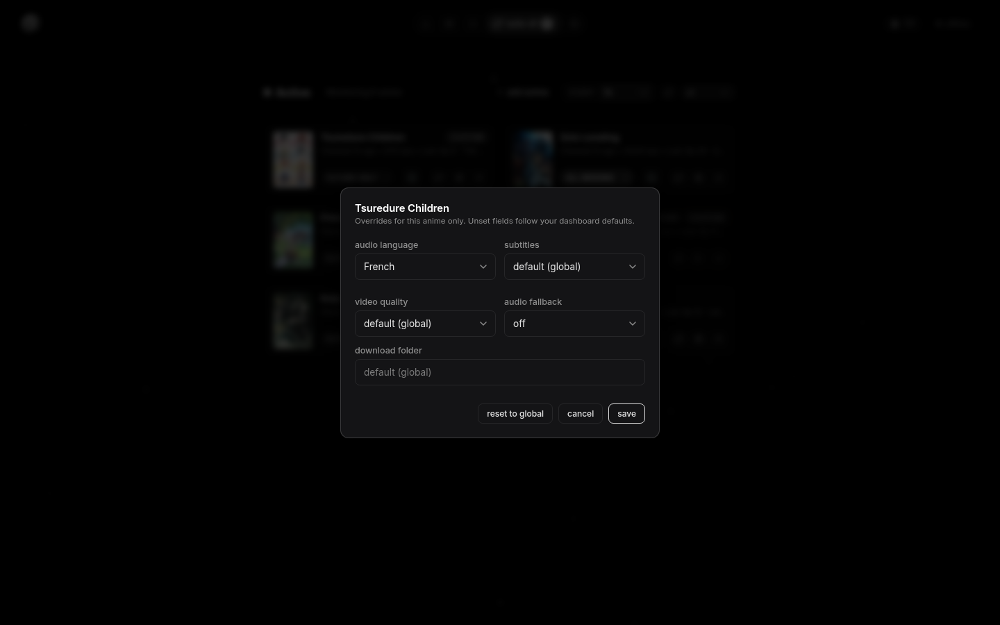

<div align="center" markdown="1">

# Crunchyroller

**Fast Crunchyroll downloader.** Web GUI, desktop window, or CLI.
Multi-track audio, soft subs, skip chapters, auto decryption, one clean MKV.

<a href="https://github.com/Vure-sh/crunchyroller/releases/latest"></a> <a href="https://github.com/Vure-sh/crunchyroller/releases"></a> <a href="https://github.com/Vure-sh/crunchyroller/stargazers"></a>


</div>

## <picture><source media="(prefers-color-scheme: dark)" srcset="readme-assets/icon-sparkles-dark.svg"></picture> Features

- <picture><source media="(prefers-color-scheme: dark)" srcset="readme-assets/icon-monitor-dark.svg"></picture> **Web GUI, desktop window, or CLI** - same app, your pick
- <picture><source media="(prefers-color-scheme: dark)" srcset="readme-assets/icon-download-dark.svg"></picture> **Auto-Downloader** with per-series settings (audio, subs, quality, folder)
- <picture><source media="(prefers-color-scheme: dark)" srcset="readme-assets/icon-headphones-dark.svg"></picture> **All dubs and soft subs in one MKV**, with skip chapters for Intro/Outro
- <picture><source media="(prefers-color-scheme: dark)" srcset="readme-assets/icon-repeat-dark.svg"></picture> **Queue with pause/resume**, batch whole seasons or series
- <picture><source media="(prefers-color-scheme: dark)" srcset="readme-assets/icon-tv-dark.svg"></picture> **Plex/Jellyfin-ready naming** out of the box

## <picture><source media="(prefers-color-scheme: dark)" srcset="readme-assets/icon-download-dark.svg"></picture> Auto-Downloader

Add an anime and new episodes download themselves. Each show gets its own mode (Future Only / All Missing) and its own settings via the gear on its card. Episodes airing before their dub stay pending until the dub drops.

<div align="center" markdown="1">
 
</div>

## <picture><source media="(prefers-color-scheme: dark)" srcset="readme-assets/icon-rocket-dark.svg"></picture> Quick Start

<details>
<summary><b>Installation</b></summary>

**Windows (easiest):** Grab the [latest release](https://github.com/Vure-sh/crunchyroller/releases/latest), drop your Widevine keys (`*.wvd`, or `client_id.bin` + `private_key.pem`) next to the exe, run it.

**From source (Python 3.10+, FFmpeg):**

```bash
git clone https://github.com/Vure-sh/crunchyroller.git && cd crunchyroller
pip install -r requirements.txt
python main.py --gui       # or --browser
```

</details>

<details>
<summary><b>Docker</b> (headless server / NAS) — contributed by <a href="https://github.com/CatChow0">@CatChow0</a></summary>

```bash
cp .env.example .env
mkdir -p data downloads    # put your Widevine keys in data/
docker compose up -d --build
```

Open `http://localhost:8000`. Episodes are saved in `DOWNLOAD_DIR`; keep the download folder empty in settings (its picker needs a desktop). To open it from another machine, set `BIND_IP` and `ALLOWED_ORIGINS` in `.env`. **The UI has no login and controls your account: never expose it to the internet without an authenticating reverse proxy.**

</details>

## <picture><source media="(prefers-color-scheme: dark)" srcset="readme-assets/icon-terminal-dark.svg"></picture> CLI

<details>
<summary><b>CLI usage</b></summary>

```bash
python main.py "<url>" --video-quality 1080p --audio-lang "ja-JP,en-US" --subs-lang "en-US"
python main.py "<series-url>" --season 1
python main.py --file urls.txt    # batch
```

</details>

<details>
<summary><b>Optional: N_m3u8DL-RE engine</b> — contributed by <a href="https://github.com/AnCry1596">@AnCry1596</a></summary>

**Optional:** [N_m3u8DL-RE](https://github.com/nilaoda/N_m3u8DL-RE) engine (thanks to [@AnCry1596](https://github.com/AnCry1596)): put it + `mp4decrypt` in `bin/`, set `"use_n_m3u8dl_re": true`. Logs (auto-redacted) are in `%LOCALAPPDATA%\crunchyroller\logs` / `~/.config/crunchyroller/logs` / `~/Library/Logs/crunchyroller`.

</details>

---

<div align="center" markdown="1">
<sub>For personal backup and educational purposes only. Support the official creators with an active Crunchyroll subscription.</sub>
</div>
