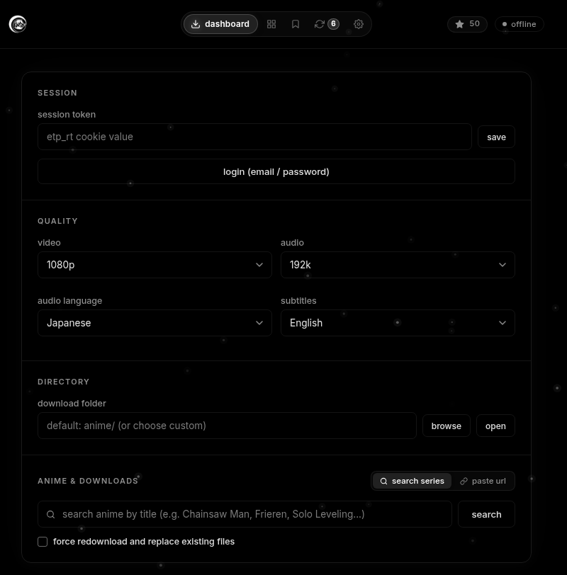

<div align="center" markdown="1">

# Crunchyroller

**Fast Crunchyroll downloader.** Web GUI, desktop window, or CLI.
Multi-track audio, soft subs, skip chapters, auto decryption, one clean MKV.

[](https://github.com/Vure-sh/crunchyroller/releases/latest)
[](https://github.com/Vure-sh/crunchyroller/releases)
[](https://github.com/Vure-sh/crunchyroller/stargazers)



</div>

## <picture><source media="(prefers-color-scheme: dark)" srcset="readme-assets/icon-sparkles-dark.svg"></picture> Features

- <picture><source media="(prefers-color-scheme: dark)" srcset="readme-assets/icon-monitor-dark.svg"></picture> **Web GUI, desktop window, or CLI** - same app, your pick
- <picture><source media="(prefers-color-scheme: dark)" srcset="readme-assets/icon-download-dark.svg"></picture> **Auto-Downloader** with per-series settings (audio, subs, quality, folder)
- <picture><source media="(prefers-color-scheme: dark)" srcset="readme-assets/icon-headphones-dark.svg"></picture> **All dubs and soft subs in one MKV**, with skip chapters for Intro/Outro
- <picture><source media="(prefers-color-scheme: dark)" srcset="readme-assets/icon-repeat-dark.svg"></picture> **Queue with pause/resume**, batch whole seasons or series
- <picture><source media="(prefers-color-scheme: dark)" srcset="readme-assets/icon-tv-dark.svg"></picture> **Plex/Jellyfin-ready naming** out of the box

## <picture><source media="(prefers-color-scheme: dark)" srcset="readme-assets/icon-download-dark.svg"></picture> Auto-Downloader

Add an anime and new episodes download themselves. Each show gets its own mode (Future Only / All Missing) and its own settings via the gear on its card. Episodes airing before their dub stay pending until the dub drops.

<div align="center" markdown="1">
 
</div>

## <picture><source media="(prefers-color-scheme: dark)" srcset="readme-assets/icon-rocket-dark.svg"></picture> Quick Start

**Windows:** grab the [latest release](https://github.com/Vure-sh/crunchyroller/releases/latest), drop your Widevine keys (`*.wvd`, or `client_id.bin` + `private_key.pem`) next to the exe, run it.

**From source** (Python 3.10+, FFmpeg):

```bash
git clone https://github.com/Vure-sh/crunchyroller.git && cd crunchyroller
pip install -r requirements.txt
python main.py --gui       # or --browser
```

## <picture><source media="(prefers-color-scheme: dark)" srcset="readme-assets/icon-terminal-dark.svg"></picture> CLI

```bash
python main.py "<url>" --video-quality 1080p --audio-lang "ja-JP,en-US" --subs-lang "en-US"
python main.py "<series-url>" --season 1
python main.py --file urls.txt    # batch
```

**Optional:** [N_m3u8DL-RE](https://github.com/nilaoda/N_m3u8DL-RE) engine (thanks to [@AnCry1596](https://github.com/AnCry1596)): put it + `mp4decrypt` in `bin/`, set `"use_n_m3u8dl_re": true`. Logs (auto-redacted) are in `%LOCALAPPDATA%\crunchyroller\logs` / `~/.config/crunchyroller/logs` / `~/Library/Logs/crunchyroller`.

## <picture><source media="(prefers-color-scheme: dark)" srcset="readme-assets/icon-globe-dark.svg"></picture> Community

- [crunchyroller-docker](https://github.com/CatChow0/crunchyroller-docker): run Crunchyroller in Docker, handy for servers and NAS. Thanks [@CatChow0](https://github.com/CatChow0)!

---

<div align="center" markdown="1">
<sub>For personal backup and educational purposes only. Support the official creators with an active Crunchyroll subscription.</sub>
</div>
